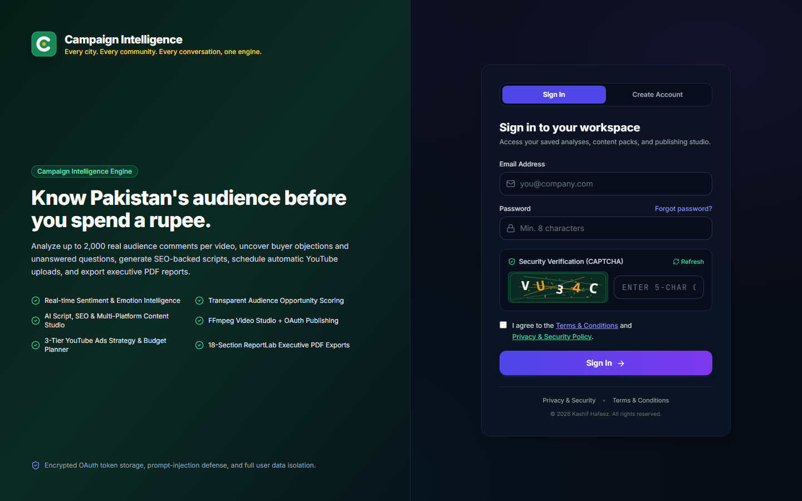
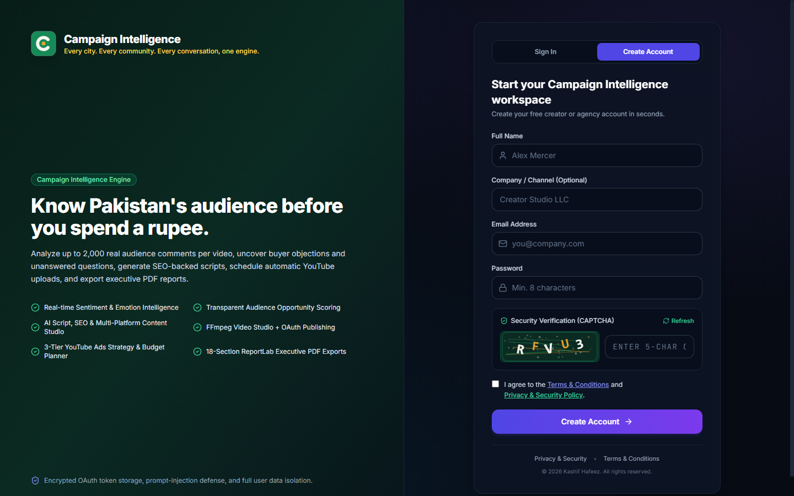
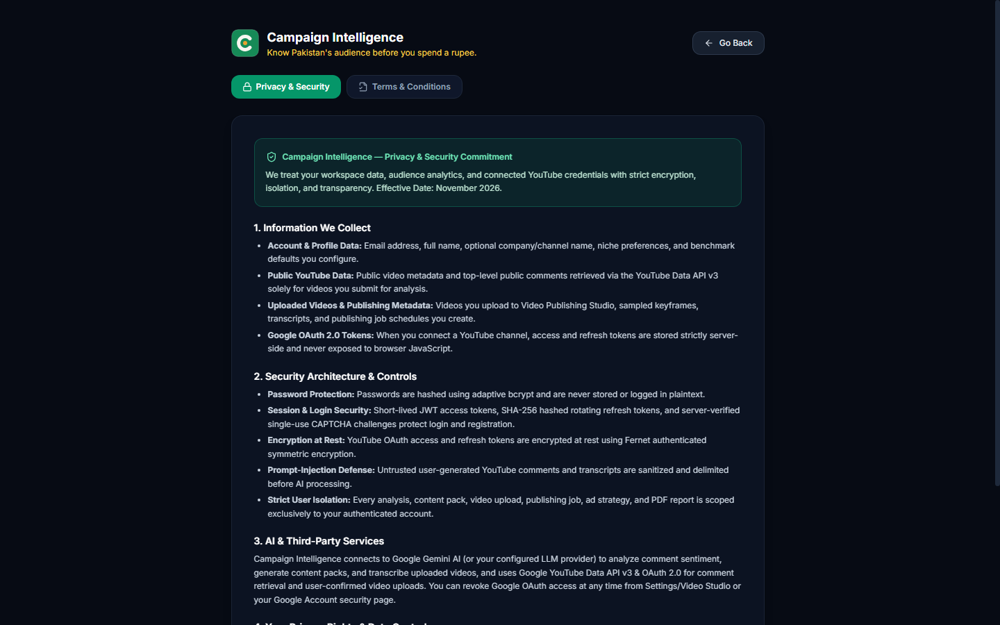
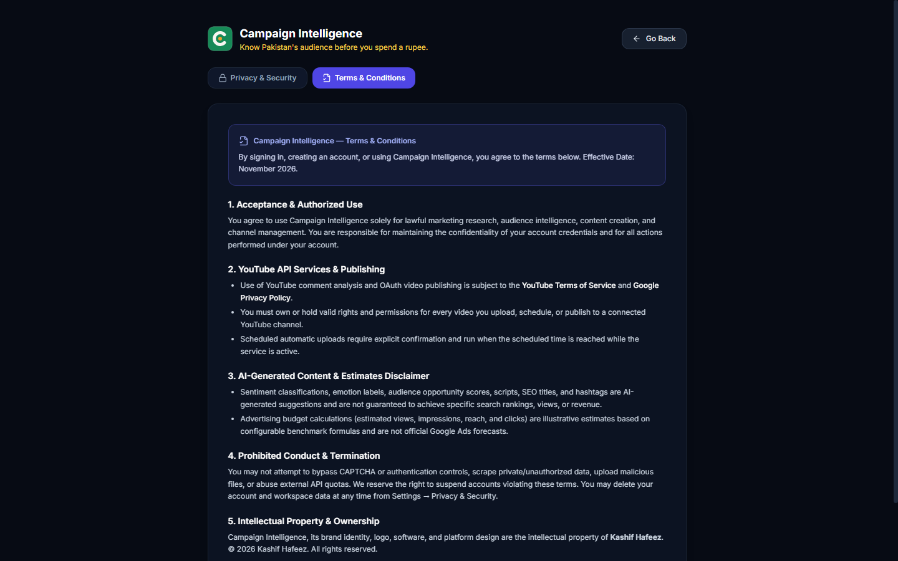

# Campaign Intelligence

> **Know Pakistan's audience before you spend a rupee.**  
> *Every city. Every community. Every conversation, one engine.*

### 🌐 Live Application
👉 **[https://campaign-intelligence-2.vercel.app](https://campaign-intelligence-2.vercel.app)**

---

## Screenshots

### Sign In & Workspace Showcase

### Create Account & Security Verification

### Privacy & Security Policy

### Terms & Conditions

---

## Features

- **Intelligence Overview** — Unified command center showing analyzed videos, total comments processed, average sentiment, generated content packs, ad strategies, published videos, and live campaign activity.
- **YouTube Sentiment Analysis** — Analyze up to 2,000 real audience comments per video with sentiment classification (`Positive`, `Negative`, `Neutral`), emotion detection (`Frustration`, `Satisfaction`, `Confusion`, `Excitement`, `Trust`), purchase intent, buying objections, complaints, FAQs, recurring keywords, and interactive visual charts.
- **Audience Intelligence** — Uncover viewer expectations, common pain points, unanswered questions, content gaps, product opportunities, marketing angles, Top 10 future video questions, and a transparent **Audience Opportunity Score (0–100)**.
- **AI Content Studio** — Generate complete campaign content packs in 5 tones (`Professional`, `Educational`, `Conversational`, `Persuasive`, `Entertaining`), including video titles, hooks, full structured scripts, SEO descriptions, hashtags, YouTube tags, multi-platform social posts (Shorts, Reels, Facebook, LinkedIn, X), 10 video ideas, and a 4-week publishing calendar.
- **Video Publishing Studio** — Upload videos, extract transcripts and key insights, generate SEO titles, descriptions, tags, and timestamped chapters, connect your YouTube channel securely, preview before publishing, and schedule automatic uploads with live countdown timers.
- **YouTube Ads Strategy & Budget Planner** — Build 12-area advertising blueprints across 7 marketing objectives with a 3-tier Budget Calculator (`Low`, `Balanced`, `Aggressive`) for estimated views, reach, impressions, and clicks.
- **Executive PDF Reports** — Export, download, and regenerate polished 18-section executive PDF intelligence reports with visual charts ready to share with clients or leadership.
- **Campaign History & Full Control** — Track all analyses, content packs, ad strategies, publishing jobs, and reports in one timeline with single-item delete and clear-all history controls across every workspace section.
- **Account Security & Privacy Controls** — CAPTCHA-protected sign-in and registration, encrypted channel connections, password management, personal data export, account deletion, and dedicated Privacy & Security and Terms & Conditions policies.

---

© 2026 Kashif Hafeez. All rights reserved.
